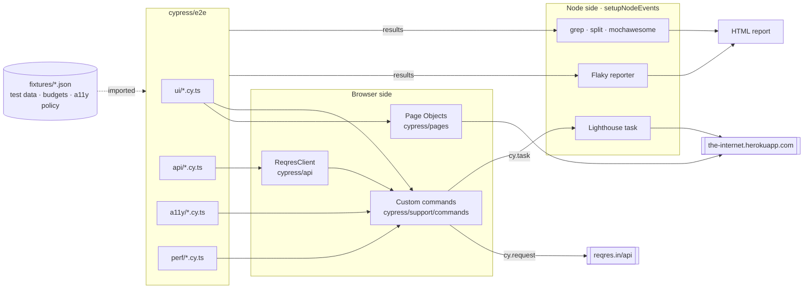
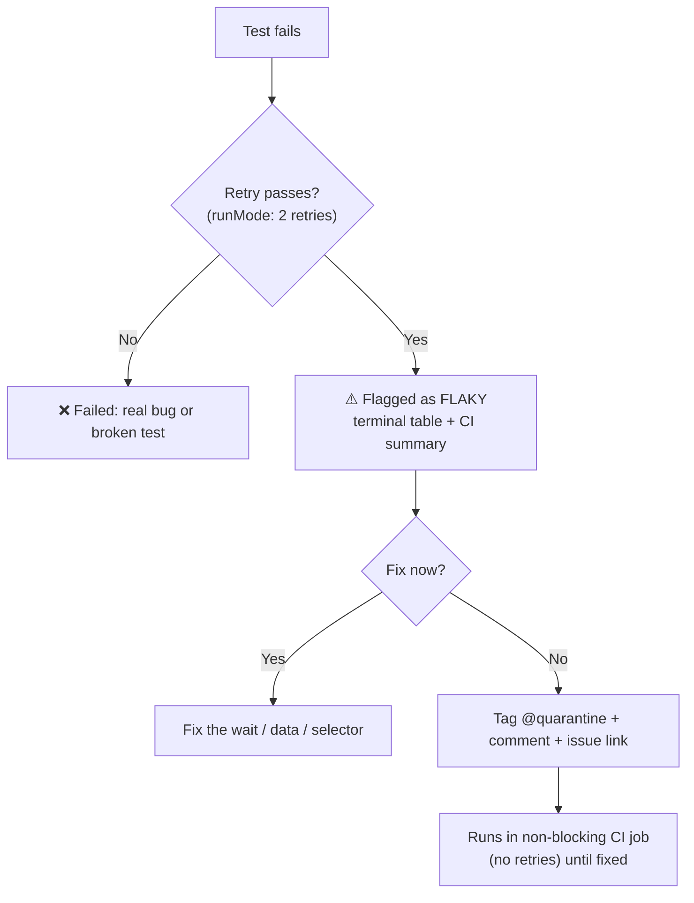
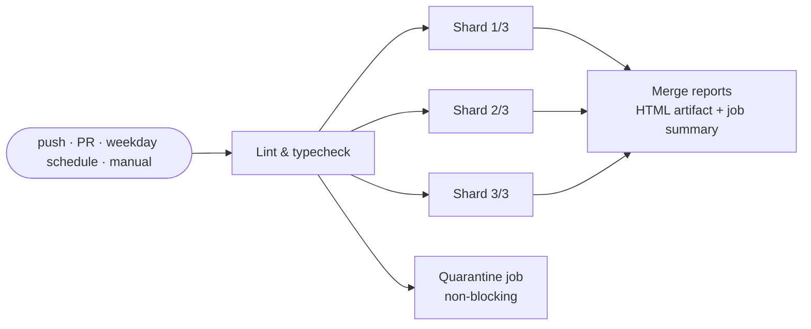

<div align="center">

# cypress-qa-starter

**A production-ready Cypress + TypeScript template for UI, API, accessibility and performance testing, with parallel CI and HTML reports out of the box.**

[](https://github.com/sergiopiedra/cypress-qa-starter/actions/workflows/ci.yml)
[](https://www.cypress.io/)
[](https://www.typescriptlang.org/)
[](https://nodejs.org/)
[](https://github.com/dequelabs/axe-core)
[](https://developer.chrome.com/docs/lighthouse)
[](https://eslint.org/)
[](LICENSE)

</div>

---

Clone it, run `npm install`, and you get **60 working tests** against two public practice targets, [the-internet](https://the-internet.herokuapp.com) (UI) and [reqres.in](https://reqres.in) (REST API). They demonstrate the patterns a real QA suite needs: typed Page Objects and custom commands, data-driven tests, WCAG checks, Lighthouse budgets, flaky-test detection and 3-way parallel CI. Swap the targets for your own app and keep the structure.

## ✨ Features

| Area                         | What you get                                                                                                                        |
| ---------------------------- | ----------------------------------------------------------------------------------------------------------------------------------- |
| 🧱 **Page Objects**          | Fluent, typed classes on a shared `BasePage`. Selectors live in one place; specs read like intent.                                  |
| 🛠️ **Typed custom commands** | `cy.loginBySession`, `cy.apiRequest<T>`, `cy.checkAccessibility`, `cy.lighthouse`, `cy.getWebVitals`, all with IntelliSense.        |
| 📋 **Data-driven tests**     | JSON fixtures generate one test per row (login matrix, dropdown options, API auth cases, HTTP status codes).                        |
| 🔌 **API testing**           | `ReqresClient` API object model over `cy.request`, with typed responses, CRUD and auth coverage, response-time budgets.             |
| ♿ **Accessibility**         | `cypress-axe` with a WCAG 2.1 AA policy, a justified **baseline** for known issues, and violations printed as a table.              |
| ⚡ **Performance**           | Lighthouse audits inside Cypress' own Chrome, plus in-browser **Core Web Vitals** (LCP, FCP, CLS), both with thresholds.            |
| 🔁 **Flaky-test handling**   | Run-mode retries, a reporter that flags tests that only passed on retry, `@quarantine` tag with a non-blocking CI job.              |
| 📊 **Reports**               | Mochawesome HTML with embedded screenshots, merged across CI shards, plus a GitHub job summary.                                     |
| 🚀 **Parallel CI**           | GitHub Actions matrix (3 shards) via `cypress-split`. No Cypress Cloud account needed.                                              |
| 🧹 **Quality gates**         | Strict TypeScript, ESLint with Cypress anti-flake rules, Prettier, Dependabot.                                                      |
| 🤖 **AI-ready**              | [`.github/copilot-instructions.md`](.github/copilot-instructions.md) teaches Copilot (and other assistants) the repo's conventions. |

## 🗺️ How it fits together



## 🚀 Quick start

**Prerequisites:** Node.js 22.19+ (`.nvmrc` pins 24) and Google Chrome for the Lighthouse suite.

```bash
git clone https://github.com/sergiopiedra/cypress-qa-starter.git
cd cypress-qa-starter
npm ci

npm run cy:open   # interactive runner
npm test          # full headless run in Chrome
```

After a headless run, open **`cypress/reports/html/index.html`** for the report.

## 📜 Scripts

| Command                                                    | What it does                                                       |
| ---------------------------------------------------------- | ------------------------------------------------------------------ |
| `npm run cy:open`                                          | Opens the Cypress app (E2E, Chrome).                               |
| `npm test`                                                 | Runs every non-quarantined spec headless in Chrome.                |
| `npm run test:electron`                                    | Same, in Cypress' bundled Electron (Lighthouse specs are skipped). |
| `npm run test:smoke`                                       | Only tests tagged `@smoke`.                                        |
| `npm run test:ui` / `test:api` / `test:a11y` / `test:perf` | One test type.                                                     |
| `npm run test:quarantine`                                  | Only tests tagged `@quarantine`.                                   |
| `npm run report:merge -- <in> <out>`                       | Merges shard reports into one HTML (used by CI).                   |
| `npm run check`                                            | Typecheck + ESLint + Prettier check. Run before every push.        |
| `npm run lint:fix` / `npm run format`                      | Auto-fix lint and formatting.                                      |
| `npm run clean`                                            | Deletes reports, screenshots, videos and temp files.               |

Filter by any tag combination with [`@cypress/grep`](https://github.com/cypress-io/cypress/tree/develop/npm/grep) syntax:

```bash
npx cypress run --expose grepTags="@api+@auth"      # API AND auth
npx cypress run --expose grepTags="@ui+-@slow"      # UI but NOT slow
npx cypress run --expose grep="sorts by"            # by title substring
```

## 📁 Project structure

```text
cypress-qa-starter/
├── .github/
│   ├── copilot-instructions.md   # testing conventions for AI assistants
│   ├── dependabot.yml
│   └── workflows/ci.yml          # lint → 3 parallel shards → merged report (+ quarantine job)
├── cypress/
│   ├── api/                      # ReqresClient + typed response contracts
│   ├── e2e/
│   │   ├── ui/                   # login, checkboxes, dropdown, tables, alerts, dynamic loading…
│   │   ├── api/                  # users CRUD, auth, HTTP status codes
│   │   ├── a11y/                 # WCAG 2.1 AA scans
│   │   └── perf/                 # Lighthouse + Core Web Vitals budgets
│   ├── fixtures/                 # test data, budgets.json, a11y-policy.json
│   ├── pages/                    # Page Objects (BasePage + one class per page)
│   ├── plugins/                  # Node-side: Lighthouse task, flaky reporter
│   ├── support/
│   │   ├── commands/             # typed custom commands (auth, api, a11y, perf)
│   │   └── e2e.ts                # registrations loaded before every spec
│   └── types/                    # domain types + ambient module declarations
├── scripts/merge-reports.mts     # shard merge + GitHub job summary
├── cypress.config.ts
├── cypress.env.example.json      # copy to cypress.env.json for local secrets
└── eslint.config.mjs
```

## 🧪 Writing tests

### Page Objects

Page Objects own selectors and actions and return chainables. **Specs own the assertions.**

```ts
// cypress/pages/LoginPage.ts
export class LoginPage extends BasePage {
  protected readonly path = '/login';

  loginAs({ username, password }: Credentials): this {
    if (username) this.usernameInput().type(username);
    if (password) this.passwordInput().type(password, { log: false });
    this.submitButton().click();
    return this;
  }
}

// cypress/e2e/ui/login.cy.ts
loginPage.visit().loginAs(users.valid);
loginPage.flash().should('contain.text', 'You logged into a secure area!');
```

### Data-driven tests

Import the fixture (so Mocha can generate the tests up front) and cast it to a domain type:

```ts
import scenarios from '../../fixtures/login-scenarios.json';

(scenarios as LoginScenario[]).forEach(({ title, outcome, message, tags = [], ...credentials }) => {
  it(`shows "${message}" for ${title}`, { tags }, () => {
    loginPage.loginAs(credentials);
    loginPage.flash().should('have.class', outcome).and('contain.text', message);
  });
});
```

Adding a row to `login-scenarios.json` adds a test; no code change needed.

### Custom commands

Commands are declared and typed in the same file, so IntelliSense always matches the implementation:

```ts
cy.loginBySession(users.valid); // cy.session-cached login
cy.apiRequest<ListResponse<User>>({ url: '/users', qs: { page: 2 } });
cy.checkAccessibility({ context: '#table1' });
cy.lighthouse('/login', budgets.lighthouse.desktop);
cy.visitWithWebVitals('/tables');
cy.getWebVitals().its('lcp').should('be.lessThan', 2500);
```

### API tests

```ts
reqres.createUser(payload).then(({ status, body }) => {
  expect(status).to.eq(201);
  expect(body).to.include(payload);
});
```

`ReqresClient` methods map 1:1 to endpoints and return typed `cy.request` responses. Add an endpoint by adding a method and its type in `cypress/api/types.ts`.

### Accessibility

`cy.checkAccessibility()` runs axe-core with the policy in [`fixtures/a11y-policy.json`](cypress/fixtures/a11y-policy.json): WCAG 2.1 A/AA rules, failing on **critical** and **serious** impacts. Known issues go in the `baseline` with a reason instead of being silenced inline:

```json
"baseline": {
  "/dropdown": [{ "rule": "select-name", "reason": "Known defect in the demo app…" }]
}
```

Violations are printed as a table in the terminal and attached to the HTML report.

### Performance

Budgets live in [`fixtures/budgets.json`](cypress/fixtures/budgets.json):

| Check               | Runs in                              | Metrics                                                                                             |
| ------------------- | ------------------------------------ | --------------------------------------------------------------------------------------------------- |
| `cy.lighthouse()`   | Chrome / Chromium / Edge             | Category scores (performance, a11y, best practices, SEO) + FCP, LCP, CLS, TBT, server response time |
| `cy.getWebVitals()` | Any Chromium browser, incl. Electron | LCP, FCP, CLS via `PerformanceObserver`                                                             |

Lighthouse attaches to the Chrome instance Cypress already controls, so no second browser is launched. A full HTML report per page is saved to `cypress/reports/lighthouse/`. Pass `'mobile'` as the third argument for a mobile audit.

## 🏷️ Tags

| Tag                          | Meaning                                  |
| ---------------------------- | ---------------------------------------- |
| `@ui` `@api` `@a11y` `@perf` | Test type (one per `describe`)           |
| `@smoke`                     | Critical path                            |
| `@auth`                      | Touches authentication                   |
| `@slow`                      | Takes more than ~5 s                     |
| `@quarantine`                | Known flaky: excluded from blocking runs |

## 🔁 Flaky-test strategy



1. **Prevention:** ESLint rejects `cy.wait(ms)`, `{ force: true }`, `.only`, `cy.pause()` and XPath. Tests wait on state, never on time.
2. **Retries:** `retries: { runMode: 2 }` absorbs transient network noise. Timing-sensitive suites raise it explicitly, with a comment.
3. **Detection:** [`flaky-reporter.ts`](cypress/plugins/flaky-reporter.ts) records every test that needed a retry, so a green build never hides instability.
4. **Quarantine:** `@quarantine` tests are excluded by default (`grepTags: '-@quarantine'`) and run in their own non-blocking CI job. See `disappearing-elements.cy.ts` for a real, randomly failing example.

## 📊 Reports

- **Locally:** `cypress/reports/html/index.html`, a single self-contained Mochawesome file with charts and embedded failure screenshots.
- **Lighthouse:** `cypress/reports/lighthouse/<page>-desktop.html`.
- **In CI:** each shard uploads its report; the `report` job merges them into the **`cypress-html-report`** artifact and writes a job summary with totals, failures and flaky tests.

## ⚙️ CI pipeline



- **Parallelism:** [`cypress-split`](https://github.com/bahmutov/cypress-split) gives each matrix job a slice of the spec files (`SPLIT` / `SPLIT_INDEX`). Change the shard count by editing `matrix.shard`.
- **Manual runs:** _Actions → CI → Run workflow_ accepts a `grepTags` filter such as `@smoke`.
- **Secrets:** add a `REQRES_API_KEY` repository secret (see below). Without it, CI falls back to the shared demo key.

## 🔧 Configuration

| Setting                     | Where                                | Notes                                                                                 |
| --------------------------- | ------------------------------------ | ------------------------------------------------------------------------------------- |
| UI base URL                 | `e2e.baseUrl` in `cypress.config.ts` | Override with `--config baseUrl=…` or `CYPRESS_BASE_URL`.                             |
| API base URL                | `expose.apiUrl`                      | Public value. Override with `--expose apiUrl=…`.                                      |
| reqres API key              | `env.reqresApiKey`                   | **Secret.** Override with `cypress.env.json` (git-ignored) or `CYPRESS_reqresApiKey`. |
| Retries, timeouts, viewport | `cypress.config.ts`                  |                                                                                       |
| Perf budgets                | `cypress/fixtures/budgets.json`      |                                                                                       |
| A11y policy and baseline    | `cypress/fixtures/a11y-policy.json`  |                                                                                       |

> [!NOTE]
> Cypress 16 replaced `Cypress.env()` with **`Cypress.expose()`** for public values and **`cy.env()`** for secrets, which keeps secrets out of the browser bundle. This template uses both.

## 🩺 Troubleshooting

<details>
<summary><b>API tests fail with “reqres rate limit reached (HTTP 429)”</b></summary>

reqres.in caps anonymous traffic (including the public `reqres-free-v1` key) per IP per day. Create a free account at [app.reqres.in](https://app.reqres.in), then:

- **Locally:** `cp cypress.env.example.json cypress.env.json` and paste your key, or `export CYPRESS_reqresApiKey=<key>`.
- **GitHub Actions:** add it as the `REQRES_API_KEY` repository secret.

</details>

<details>
<summary><b>Lighthouse specs are skipped</b></summary>

Lighthouse needs a Chromium browser launched by Cypress. Run with `--browser chrome` (the default for `npm test`). In Electron and Firefox the suite is marked pending by design; Core Web Vitals still run.

</details>

<details>
<summary><b>“Cypress failed to start … bad option: --no-sandbox”</b></summary>

The process inherited `ELECTRON_RUN_AS_NODE=1`, typically when it was launched from an editor extension host. Run `unset ELECTRON_RUN_AS_NODE` (or `env -u ELECTRON_RUN_AS_NODE npm test`).

</details>

<details>
<summary><b>A test is flagged as flaky</b></summary>

Check the flaky table at the end of the run (or the CI job summary). Fix the underlying wait/data issue, or quarantine it following the [flaky-test strategy](#-flaky-test-strategy).

</details>

## 🔄 Adapting to your app

1. Point `baseUrl` and `expose.apiUrl` at your environments.
2. Replace the Page Objects in `cypress/pages/` and the client in `cypress/api/` with your own.
3. Add `data-cy` attributes to your app and enable the `cypress/require-data-selectors` lint rule.
4. Re-baseline `a11y-policy.json` and recalibrate `budgets.json` against your app.
5. Update [`.github/copilot-instructions.md`](.github/copilot-instructions.md) with any convention you change.

## 📄 License

[MIT](LICENSE)
